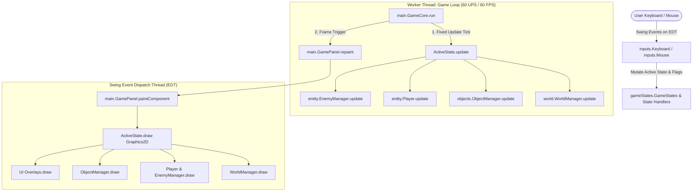

# Architecture.md - System Design & Architectural Specification

This document details the architectural topology, runtime subsystems, component interactions, and threading model of the **Tubes-PO2** pure Java game engine.

---

## 1. High-Level Architectural Paradigm

The architecture follows a hybrid **Model-View-Controller (MVC)** adapted for real-time 2D game loops:

---

## 2. Core Runtime Subsystems

### 2.1 Game Loop & Time-Step Engine (`main/GameCore.java`)
- **Pattern:** Semi-fixed timestep accumulator game loop.
- **Update Frequency (UPS):** 60 Updates Per Second (delta accumulator target `10^9 / 60` ns).
- **Render Frequency (FPS):** Target 60 Frames Per Second.
- **Display Pipeline:** Calls `GamePanel.repaint()`, which delegates rendering to Swing's double-buffered `paintComponent(Graphics g)`. A uniform transform matrix scales logical resolution ($1248 \times 672$) to actual window dimensions.

### 2.2 State Machine Subsystem (`gameStates/`)
- **State Registry:** Defined by enum [`GameStates`](file:///c:/Users/HP/Rafi/MyProject/Tubes-PO2/src/gameStates/GameStates.java) (`MENU`, `PLAYING`, `OPTIONS`, `QUIT`).
- **State Interface:** [`StateMethods`](file:///c:/Users/HP/Rafi/MyProject/Tubes-PO2/src/gameStates/StateMethods.java) mandates lifecycle methods: `update()`, `draw(Graphics g)`, and mouse/keyboard event hooks.
- **Active State Manager:** [`PlayStates`](file:///c:/Users/HP/Rafi/MyProject/Tubes-PO2/src/gameStates/PlayStates.java) is the master coordinator for active gameplay, holding the player, entities, camera offset, and contextual modal overlays.

### 2.3 Entity & Combat Hierarchy (`entity/`)
- **Root Class:** [`Entity`](file:///c:/Users/HP/Rafi/MyProject/Tubes-PO2/src/entity/Entity.java) holds spatial coordinates (`x`, `y`), logical bounding boxes (`width`, `height`), and AABB collision `hitBox` (`Rectangle2D.Float`).
- **Player Subsystem:** [`Player`](file:///c:/Users/HP/Rafi/MyProject/Tubes-PO2/src/entity/Player.java) encapsulates movement physics, jumping, i-frames, combo attacks, equipment stats, and level/EXP progression.
- **Enemy Subsystem:** [`Enemy`](file:///c:/Users/HP/Rafi/MyProject/Tubes-PO2/src/entity/Enemy.java) provides baseline patrol AI, player tracking, gravity, and fall checks.
  - Subclasses: `Slime`, `Skullwolf`, `BlueGolem`, `BringerOfDeath`, and multi-phase `Boss` / `DemonBoss`.
- **Enemy Management:** [`EnemyManager`](file:///c:/Users/HP/Rafi/MyProject/Tubes-PO2/src/entity/EnemyManager.java) stores active enemies in homogeneous lists and handles hit-detection against the player's attack box.

### 2.4 Physics & Tile Collision Subsystem (`utilitytools/HelpMethods.java`)
- **Grid Representation:** Level collision is mapped as a 2D integer array `int[][] tilesData`.
- **AABB vs Tile Grid:**
  - `canMoveHere(x, y, w, h, tilesData)`: Discretizes bounding boxes into tile column and row ranges to perform $O(1)$ grid solid checks.
  - `IsEntityOnFloor(...)`: Samples bottom-edge collision points to determine grounded vs airborne states.
  - `GetEntityPosNextToWall(...)` and `GetEntityPosUnderRoofOrAboveFloor(...)`: Resolves position offsets upon collision to prevent penetration.

### 2.5 World & Camera Subsystem (`world/`)
- **World & Tile Storage:** [`World`](file:///c:/Users/HP/Rafi/MyProject/Tubes-PO2/src/world/World.java) encapsulates the tile matrix loaded from text/CSV map files.
- **Tileset Slicing:** [`WorldManager`](file:///c:/Users/HP/Rafi/MyProject/Tubes-PO2/src/world/WorldManager.java) splits source tileset atlases into 16x16 sub-images cached in a flat array.
- **Camera Offset:** `xLvlOffset` smoothly scrolls horizontal world coordinates centered on player movement boundaries.

### 2.6 Audio Engine (`audio/AudioPlayer.java`)
- Uses standard Java Sound API (`javax.sound.sampled`).
- Manages dual channels:
  - **Songs Channel:** Continuous loop clips with logarithmic gain decibel conversion.
  - **Effects Channel:** Fire-and-forget SFX with position reset (`setMicrosecondPosition(0)`).

### 2.7 Persistence Subsystem (`utilitytools/SaveLoadManager.java`)
- Formats player progression, coordinates, equipped equipment IDs, inventory list, and world indices into key-value pairs stored in `savegame.txt`.

---

## 3. Threading & Concurrency Model

The application operates across two primary threads:

1. **Java Swing Event Dispatch Thread (EDT):**
   - Handles OS window events, keyboard strokes, mouse clicks, and triggers `paintComponent()`.
2. **Custom Game Loop Thread (`gameThread`):**
   - Spawns from `GameCore.startGameLoop()`.
   - Executes non-stop game simulation (`update()`) at 60 Hz.

> ⚠️ **Critical Architectural Rule:** Any state mutated by the EDT (such as user pausing, clicking menu buttons, or opening overlays) that is consumed by `gameThread` MUST maintain memory visibility via `volatile` accessors.
