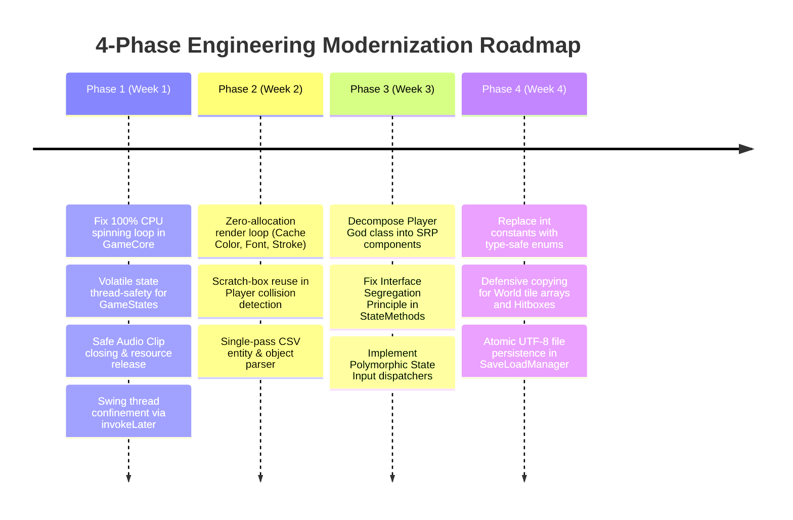

# Roadmap.md - Engineering & Feature Modernization Roadmap

This document outlines the four-phase engineering modernization plan and the feature evolution milestones for the **Tubes-PO2** project.

---

## 1. Engineering Modernization Roadmap (Technical Debt Remediation)

### Phase 1: Critical Stability & Concurrency (Days 1–7)
- [x] **Fix 100% CPU Busy-Wait:** Adaptive frame-pacing sleep implemented in `GameCore.run()` (`Thread.sleep`/`Thread.yield`).
- [x] **Thread Visibility:** `GameStates.state` declared `volatile` with `Objects.requireNonNull` validation in `GameStates.java`.
- [x] **Native Resource Disposal:** `destroy()` and `close()` implemented for audio clips in `AudioPlayer.java` and called on `GameCore.stopGame()`.
- [x] **Swing Confinement:** Wrapped `GameCore::new` in `SwingUtilities.invokeLater()` inside `Main.main()`.

### Phase 2: GC Optimization & Hot-Path Tuning (Days 8–14)
- [x] **Heap Zero-Allocation:** All per-frame `new Color(...)`, `new Font(...)`, and `new BasicStroke(...)` in `PauseOverlay`, `UrmButton`, `SoundButton`, `GameOptions`, `MainMenu`, `LevelCompletedOverlay`, and `ObjectManager` cached as static final constants or instance fields.
- [x] **Collision Scratch Rectangles:** Per-tick `new Rectangle2D.Float` replaced with `scratchHitbox` reuse in `Player.java` and `PlayerPhysics.java`.
- [x] **Single-Pass Entity Loader:** Replaced multi-pass file reading with `SinglePassLevelParser.java`, streaming maps and entity spawns in 1 pass.
- [x] **Autoboxing Reduction:** Replaced `Map<Integer, BufferedImage[][]>` in `EnemyManager.java` with direct 3D primitive array `enemySprites[TOTAL_ENEMY_TYPES][][]`.

### Phase 3: SOLID Decoupling & Modular Architecture (Days 15–21)
- [x] **Deconstruct Player God Class:** Monolithic `Player.java` split into:
  - `PlayerPhysics.java` (gravity, platform collision, knockback, dash)
  - `PlayerCombat.java` (i-frames, charge attacks, attack boxes)
  - `PlayerInventory.java` (items list, equipment slots, defense calculation)
  - `PlayerStats.java` (HP, Mana, Level, EXP formulas)
  - `PlayerHUD.java` (HUD drawing moved out of core entity package)
- [x] **Interface Segregation:** Purged dead stubs from `StateMethods.java` mandating only essential state lifecycle methods.
- [x] **Polymorphic Input Routing:** Replaced monolithic switch in `Keyboard.java` and `Mouse.java` with polymorphic delegate `InputDispatcher.java`.

### Phase 4: Effective Java & Clean Persistence (Days 22–30)
- [x] **Type-Safe Enums:** Implemented `EnemyType.java`, `ObjectType.java`, and `Direction.java` according to Effective Java Item 34 while maintaining int backward compatibility.
- [x] **Defensive Copying:** Implemented `World.getClonedWorldData()` and `PlayerInventory.getItemsCopy()` with unmodifiable views.
- [x] **Atomic Save Files:** `SaveLoadManager.java` writes to `.tmp` file before executing `StandardCopyOption.ATOMIC_MOVE` with UTF-8 encoding.

---

## 2. Feature & Gameplay Evolution Milestones

### Milestone 1: Multi-Level Campaign Progression
- [x] Seamless transition between Level 1 (Tutorial Map), Level 2 (Jungle), and Level 3 (Castle) via `WorldManager` and `SinglePassLevelParser`.
- [x] Persistent player progression saved across level completions in `savegame.txt`.

### Milestone 2: Audio & Settings System Polish
- [x] Full volume attenuation control through logarithmic decibel gain (`ToneSynthFallback` & `AudioPlayer`).
- [x] Resilient audio synthesis preventing game crashes when audio files are absent or devices unavailable.

### Milestone 3: Particle & Visual Polish
- [x] Hit-sparks, dust particles upon jumping/landing/dashing, and floating damage numbers via `ParticlePool` and `FloatingTextPool`.
- [x] Smooth camera interpolation (lerping) replacing instant snapping in `PlayStates.java`.
