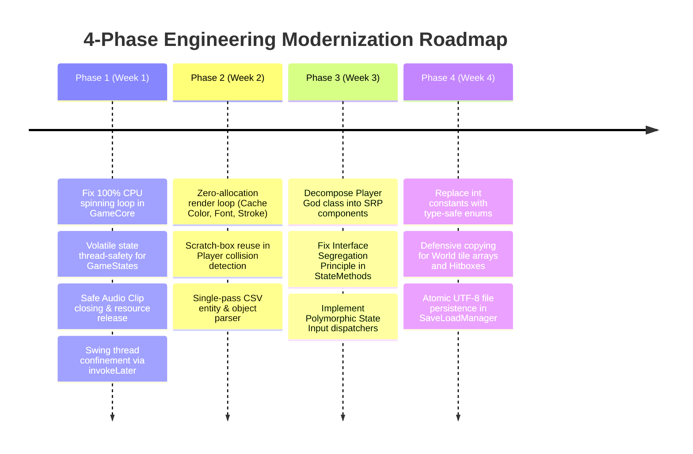

# Roadmap.md - Engineering & Feature Modernization Roadmap

This document outlines the four-phase engineering modernization plan and the feature evolution milestones for the **Tubes-PO2** project.

---

## 1. Engineering Modernization Roadmap (Technical Debt Remediation)

### Phase 1: Critical Stability & Concurrency (Days 1–7)
- [ ] **Fix 100% CPU Busy-Wait:** Introduce adaptive frame-pacing sleep in `GameCore.run()` when delta is satisfied.
- [ ] **Thread Visibility:** Convert `GameStates.state` to private with `volatile` accessors to eliminate JMM race conditions between Swing EDT and `gameThread`.
- [ ] **Native Resource Disposal:** Implement `close()` methods for all audio `Clip` instances in `AudioPlayer.java` upon exit.
- [ ] **Swing Confinement:** Wrap `new GameCore()` in `SwingUtilities.invokeLater()` inside `Main.main()`.

### Phase 2: GC Optimization & Hot-Path Tuning (Days 8–14)
- [ ] **Heap Zero-Allocation:** Replace all per-frame `new Color(...)`, `new Font(...)`, and `new BasicStroke(...)` in UI overlays and buttons with cached constants.
- [ ] **Collision Scratch Rectangles:** Eliminate per-tick `new Rectangle2D.Float` instantiations in `Player.updatePos()`.
- [ ] **Single-Pass Entity Loader:** Replace the 5 redundant file-reading passes in `EnemyManager.addEnemies()` with a single-pass streaming parser.
- [ ] **Autoboxing Reduction:** Replace `Map<Integer, BufferedImage[][]>` in `EnemyManager` with primitive array lookups or `EnumMap`.

### Phase 3: SOLID Decoupling & Modular Architecture (Days 15–21)
- [ ] **Deconstruct Player God Class:** Split `Player.java` into:
  - `PlayerPhysics` (movement, collision, gravity)
  - `PlayerCombat` (i-frames, attacks, knockback)
  - `PlayerInventory` (encapsulated items & equipment)
  - `StatusBarUI` (HUD drawing moved out of entity package)
- [ ] **Interface Segregation:** Remove `triggerHeavyHit` from `StateMethods` interface so that menus/options are not forced to maintain dead stubs.
- [ ] **Polymorphic Input Routing:** Replace `switch(GameStates.state)` in `Keyboard.java` and `Mouse.java` with a dynamic current-state delegate.

### Phase 4: Effective Java & Clean Persistence (Days 22–30)
- [ ] **Type-Safe Enums:** Refactor raw int constants in `Konstanta.java` into structured enums (`EnemyType`, `ObjectType`, `Direction`).
- [ ] **Defensive Copying:** Guard `World.getWorldData()` against external array mutation.
- [ ] **Atomic Save Files:** Refactor `SaveLoadManager` to write to a temporary file before performing an atomic rename via `StandardCopyOption.ATOMIC_MOVE`, enforcing `StandardCharsets.UTF_8`.

---

## 2. Feature & Gameplay Evolution Milestones

### Milestone 1: Multi-Level Campaign Progression
- Seamless transition between Level 1 (Tutorial Map), Level 2 (Jungle), and Level 3 (Castle).
- Persistent player progression saved across level completions.

### Milestone 2: Audio & Settings System Polish
- Full volume attenuation control through the options screen slider.
- Distinct background music tracks per level theme.

### Milestone 3: Particle & Visual Polish
- Hit-sparks, dust particles upon jumping/landing, and floating damage numbers.
- Smooth camera interpolation (lerping) replacing instant snapping.
